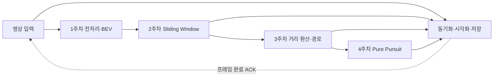

# Dolbat Toy Project · ROS2 Humble

녹화 주행영상에서 차선을 검출하고 B-spline 중앙 경로와 Pure Pursuit 조향각을 계산합니다. 기존 CPU 기반 프로젝트를 **Ubuntu 22.04 + ROS2 Humble**의 주차별 노드로 나눴습니다. 실제 차량에 조향 명령을 보내지는 않습니다.

원본 `data/dolbat_toyproject.mp4`와 설정·기준 수치를 저장소에 포함했습니다. 영상 파일을 따로 내려받거나 Windows 폴더 경로를 수정할 필요가 없습니다.

## Ubuntu에서 실행

ROS2 Humble이 `/opt/ros/humble`에 설치된 Ubuntu 22.04에서 실행합니다.

```bash
git clone https://github.com/tjsong1234/Dolbat_Toyproject.git
cd Dolbat_Toyproject
./scripts/run.sh
```

첫 실행은 필요한 apt 의존성을 확인하고, 없으면 설치를 진행합니다. 이때 `sudo` 암호가 필요할 수 있습니다. 이어서 저장소 안의 `ros2_ws`를 빌드하고 전체 영상을 처리합니다. 시스템 Python을 바꾸거나 `.bashrc`를 수정하지 않습니다. **Humble의 시스템 Python 3.10을 사용하며 기존 Windows Python 3.12 가상환경을 복사하지 않습니다.**

이미 clone한 뒤 새 버전을 받을 때는 다음 두 명령이면 됩니다.

```bash
git pull --ff-only
./scripts/run.sh
```

기본 실행은 화면 창 없이 영상을 저장합니다. Ubuntu 데스크톱에서 실행 화면도 보려면 다음처럼 실행합니다.

```bash
./scripts/run.sh --display
```

설치와 실행을 분리하거나 의존성을 미리 확인할 수도 있습니다.

```bash
./scripts/setup_ubuntu.sh
./scripts/setup_ubuntu.sh --check-only
./scripts/run.sh --no-install
```

`run.sh`는 빌드를 매번 호출하지만 바뀐 소스만 갱신합니다. **pull로 코드를 바꾼 뒤에는 `--no-build`를 사용하지 마세요.** 이미 빌드한 같은 코드의 재실행에만 `./scripts/run.sh --no-install --no-build`를 사용할 수 있습니다.

## 노드와 데이터 흐름



| 역할 | 처리 내용 | 주요 토픽 |
|---|---|---|
| 영상 입력 | 원본 영상 읽기, 시각·프레임 번호 부여 | `/dolbat/video` |
| 1주차 전처리 | 기존 ROI, BEV, 차선 마스크와 노면 표시 억제 | `/dolbat/preprocessed` |
| 2주차 차선 검출 | Sliding Window, 좌우·부분 관측과 실패 상태 | `/dolbat/lanes`, `/dolbat/sliding_debug` |
| 3주차 경로 생성 | 픽셀→cm, B-spline 중앙선·폭 공동 추정 | `/dolbat/path` |
| 4주차 제어 계산 | 후륜축 좌표 변환, 원 교점 LP, 조향각 | `/dolbat/control` |
| 동기화·저장 | 같은 프레임의 네 화면 합성, CSV·MP4 저장 | `/dolbat/frame_done` |

전처리 이미지 전체를 이후 모든 노드로 계속 복사하지 않습니다. 차선 검출 다음에는 실제 관측과 경로에 필요한 수치 자료를 전달하고, 시각화는 프레임 번호가 같은 원본·검출 화면·경로·제어 결과를 모읍니다. 입력은 완료 ACK를 기준으로 진행 중인 프레임 수를 제한합니다. 처리 속도가 느려지면 기다리며 프레임을 건너뛰지 않습니다.

세 패키지로 구성합니다.

```text
ros2_ws/src/
├── dolbat_core/        # ROS2와 독립된 기존 인지·계획·제어 계산
├── dolbat_interfaces/  # 프레임 번호·상태·수치의 메시지 정의
└── dolbat_pipeline/    # 주차별 ROS2 노드와 launch
```

## 설정과 실행 옵션

기존 ROI·BEV·검출·B-spline 설정과 과제 제공 치수는 `dolbat_core`의 `resources`에 포함합니다. 조향각은 전방 X·왼쪽 Y를 기준으로 **좌회전 +, 우회전 -**이며 도와 라디안을 함께 기록합니다. LD는 1.7m, 축간거리는 0.55m입니다. 후륜축에서 **원본 영상 하단**까지 0.9m라는 제공 값을 사용하며 BEV 하단에 무조건 0.9m를 더하지 않습니다. 영상 중앙과 차량 중심선, BEV 전방축과 차량 heading의 정렬은 가정입니다.

```bash
# 원본 영상 속도로 재생: 기본값
./scripts/run.sh replay_rate:=1.0

# 입력 시각을 유지하고, 완료 ACK가 허용하는 속도로 처리량 측정
./scripts/run.sh replay_rate:=0.0

# 출력 폴더를 명시하고 창 없이 실행
./scripts/run.sh output:="$HOME/dolbat_results/run_01" display:=false

# 진행 중인 프레임 수 제한 조정: 기본 4
./scripts/run.sh max_in_flight:=4
```

원본 영상은 640×480, 24FPS, 564프레임(23.5초)입니다. 저장 영상의 재생 FPS와 실제 파이프라인 처리량은 구분합니다. ROS2의 통신·직렬화 비용이 추가되므로 Windows 단일 프로그램에서 측정한 25.3FPS를 ROS2의 성능이라고 보고하지 않습니다. 실제 ROS2 처리량은 실행 결과의 `summary.json`을 확인하세요.

## 결과 확인

기본 결과는 `outputs/날짜_시간/`에 생성됩니다.

- `01_final_four_panels.mp4`: 원본, BEV Sliding Window, 경계·경로·LP, 조향각의 네 화면
- `02_green_path_control.mp4`: 초록색 경로와 목표점 LP, 조향각
- `records/control.csv`, `records/rear_paths.csv`: 프레임별 목표점·조향각·경로
- `graphs/`, `images/`: 시간 그래프와 대표 실행 화면
- `summary.json`: 프레임 수·실행 상태·측정 처리량

입력·출력의 프레임 수와 순서를 확인하고, 마지막 프레임까지 저장한 뒤 노드들이 종료됩니다. LP가 없거나 검출에 실패하면 상태로 구분하며, 과거 조향각을 정상 결과처럼 재사용하지 않습니다.

## 테스트와 전체 영상 검증

```bash
# 한 번 빌드한 뒤
./scripts/test.sh

# 원본 전체를 ROS2 노드로 처리한 뒤 기준 결과와 비교
./scripts/run.sh replay_rate:=0.0 output:="$PWD/outputs/check"
/usr/bin/python3 scripts/verify_ros_run.py --output outputs/check
```

검증기는 564개 프레임의 순서와 누락, 기존 기준 경로·조향각과의 수치 차이, LP의 원·선분 관계, 고정 좌표축, 저장한 두 영상의 전체 디코딩을 확인합니다. 플랫폼에 따른 작은 부동소수점 차이는 명시된 허용 오차로 검사하며 프레임 누락을 허용하지 않습니다.

[GitHub Actions](https://github.com/tjsong1234/Dolbat_Toyproject/actions)는 Ubuntu 22.04 기반 `ros:humble-ros-base-jammy`에서 빌드·테스트·실제 전체 영상 실행을 수행합니다. 실행별 성공 여부와 산출물은 Actions의 로그와 `humble-…-validation` artifact를 확인하세요. 이 검증은 녹화영상 처리 검증이며 실제 차량의 폐루프 추종 성능이나 실시간 카메라의 지연 보장은 아닙니다.

설치·운영 문제는 [Ubuntu 실행 안내](docs/ubuntu_setup.md)를 참고하세요.
